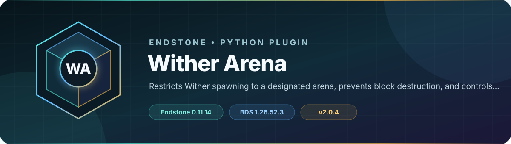

<!-- endstone-professional-header:start -->
<p align="center">
  
</p>

<p align="center">
  <a href="https://github.com/TheNINJALLO/endstone-wither-arena/actions/workflows/wheel-release.yml"></a>
  <a href="https://github.com/TheNINJALLO/endstone-wither-arena/releases/latest"></a>
</p>

<p align="center">
  
  
  
  =3.10" src="https://img.shields.io/badge/Python-%3E=3.10-3776AB?style=flat-square&amp;logo=python&amp;logoColor=white">
</p>

<p align="center">
  <strong>Restricts Wither spawning to a designated arena, prevents block destruction, and controls mob spawning and block breaking in the arena.</strong>
</p>

<p align="center">
  <a href="#what-it-does">What it does</a> &bull;
  <a href="#how-to-use">How to use</a> &bull;
  <a href="#commands-and-permissions">Commands</a> &bull;
  <a href="#install">Install</a> &bull;
  <a href="https://github.com/TheNINJALLO/endstone-wither-arena/releases">Releases</a>
</p>

## Overview

Restricts Wither spawning to a designated arena, prevents block destruction, and controls mob spawning and block breaking in the arena. This release is aligned with Endstone 0.11.8 and Minecraft Bedrock Dedicated Server 1.26.40, and is distributed as a Python wheel for direct installation in an Endstone server.

## What it does

- Restricts Wither spawning to a fixed Overworld arena and blocks Withers elsewhere.
- Prevents explosion damage, unwanted mob spawns, and unauthorized block changes inside the arena.
- Provides a temporary operator repair mode that suspends block protection.

## How to use

1. Review and, if necessary, change the arena boundary constants and allowed entity/block sets before building the wheel.
2. Start the server and test Wither spawning just inside and outside every arena boundary.
3. Run `/arena-repair on` before maintenance and always run `/arena-repair off` immediately afterward.

## Commands and permissions

| Command / usage | What it does | Access |
|---|---|---|
| `/arena-repair [on\|off]` | Toggle arena repair mode (disables block protection for all players) | `wither_arena.repair` |

## Compatibility

| Component | Supported version |
|---|---|
| Endstone | `0.11.8` |
| Endstone API | `0.11` |
| Bedrock Dedicated Server | `1.26.40` |
| Python | `>=3.10` |
| Plugin release | `v2.0.4` |

## Install

Download the wheel from the matching GitHub release:

```bash
gh release download v2.0.4 --repo TheNINJALLO/endstone-wither-arena --pattern "*.whl"
```

Copy the downloaded wheel into the server's `plugins/` directory, remove any older wheel for the same plugin, and restart Endstone.

> [!IMPORTANT]
> Use Endstone `0.11.8` with BDS `1.26.40`. Back up worlds and plugin data before upgrading a production server.

## Configuration and secrets

Runtime databases, logs, local `.env` files, server directories, and root `config.toml` files are excluded from source releases. When an example configuration is provided, copy it locally and keep live tokens, passwords, webhook URLs, and server identifiers out of Git.

## Release automation

Every `v*` tag runs [the wheel release workflow](.github/workflows/wheel-release.yml), builds the package in a clean GitHub runner, stores the wheel as a workflow artifact, and attaches it to the matching GitHub release.
<!-- endstone-professional-header:end -->
